<div align="center">

# mFix

**The Mac, fixed.**

Windows 11 window management for macOS 26. Yes, Windows. On purpose.

[](https://github.com/Zingzy/mFix/releases/latest) [](https://github.com/Zingzy/mFix/releases) [](https://github.com/Zingzy/mFix/actions/workflows/ci.yml) [](LICENSE)  

**[Download mFix.dmg](https://github.com/Zingzy/mFix/releases/latest/download/mFix.dmg)**

<picture>
  <source media="(prefers-color-scheme: dark)" srcset="docs/images/snap-assist-dark.png">
  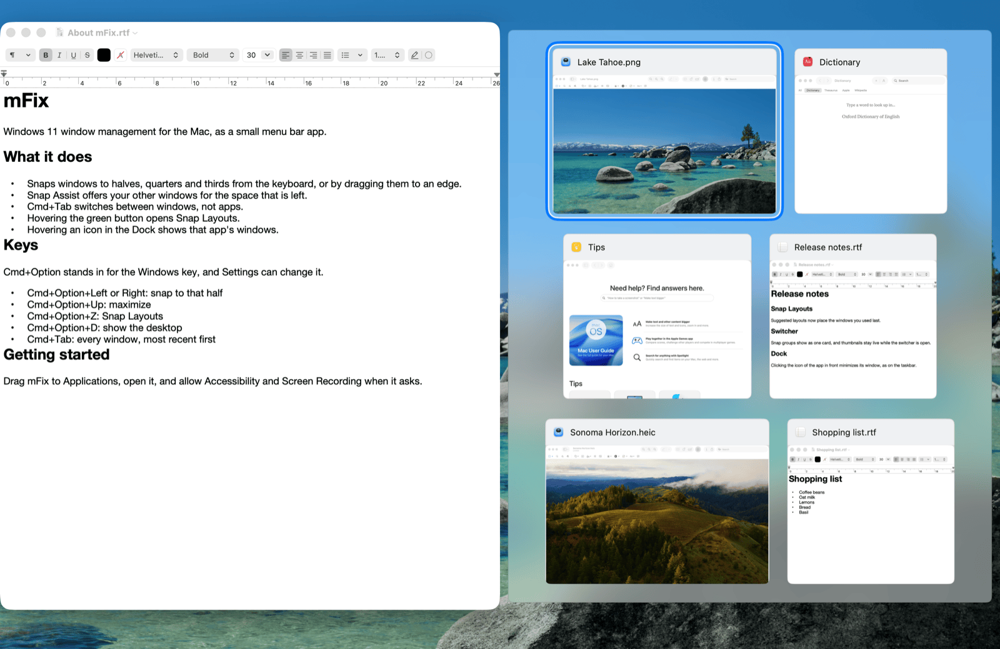
</picture>

</div>

## The hot take

The Mac is sold as the productivity machine. It isn't. It's the pretty machine. Productivity is what people say to justify the price.

Use it for a week after Windows 11 and count how often you fight the window you're looking at. Windows does this part better. Not a little better. Much better. It hurts to type that, but it's true, and Apple has had 25 years to notice.

So mFix copies Windows. The snapping, the switcher, the taskbar habits, the Explorer keys. Native Swift, no Electron, a few MB of RAM.

**F\*CK MACOS** window management. Here is the case.

| You want to | macOS 26 | Windows 11 |
|---|---|---|
| Put two windows side by side | Drag one to the edge. The other half of the screen sits there empty and asks nothing. | Snap one. Snap Assist asks which window goes in the other half. |
| Switch to a window | Cmd+Tab shows apps. Pick an app whose windows are minimized and you get its menu bar and nothing else. | Alt+Tab shows every window, with a picture of each. |
| Use the green button | Zoom, then full screen, then a tile menu, then a bigger tile menu. Four careers in fifteen years. | Hover maximize, get a grid of layouts, click a zone. |
| Cut and paste a file | Finder has no Cut. In 2026. | Ctrl+X, Ctrl+V. |
| Open a file | Enter renames it. | Enter opens it. |
| Delete a file | Delete does nothing. You need Cmd+Delete. | Delete. |
| Go to a path | Cmd+Shift+G, obviously. | Click the address bar and type. |
| Look at an app's windows | Hover the Dock and read the app's name, which you knew, because you were looking at its icon. You can't turn that tooltip off. | Hover the taskbar and see every window. |
| Keep a window on top | You can't, unless it's a Picture in Picture video or a Stickies note. | PowerToys, Win+Ctrl+T. |
| Open the task manager | Cmd+Option+Esc gives you a list and one button. | Ctrl+Shift+Esc. |

## Install

1. Download [mFix.dmg](https://github.com/Zingzy/mFix/releases/latest/download/mFix.dmg). It needs macOS 26 (Tahoe) or later.
2. Drag mFix into Applications and open it.
3. macOS blocks it, because notarizing costs $99 a year and this is free. Go to System Settings, Privacy & Security, scroll to Security and click **Open Anyway**. Or run this:

   ```sh
   xattr -dr com.apple.quarantine /Applications/mFix.app
   ```

4. Grant **Accessibility** and **Screen Recording** when mFix asks. Its menu bar icon has a shortcut to both.

Quit Rectangle, AltTab and other window managers first. They want the same keys, and whoever registers first wins.

<details>
<summary><b>Why each permission</b></summary>

| Permission | What mFix uses it for |
|---|---|
| Accessibility | Moving and resizing windows, reading the Dock's icons, watching the keyboard and mouse for drags and chords, and the Finder keys. Nothing works without it. |
| Screen Recording | Window thumbnails in the switcher, Snap Assist and Dock previews, and the live copy Always on Top floats over other apps. |
| Automation for Finder | Asked the first time Cmd+V moves files into a selected folder. mFix asks Finder for the front folder and the selection, then tells Finder to move the files. |

macOS ties these grants to the app's signature. Every release is signed with the same certificate, so grants survive updates. If one stops working anyway, remove mFix from that list with the minus button and add it again.

</details>

<details>
<summary><b>Turn off the Mac's own tiling</b></summary>

macOS 15 and later have their own drag-to-edge tiling. With both on you get two previews. In System Settings, go to Desktop & Dock, then Windows, and turn off "Drag windows to screen edges to tile".

</details>

## The Windows key

Macs don't have one, so mFix uses a chord. Below, **Win** means **Cmd+Option**. If that clashes with an app you use, switch it to Ctrl+Option or Ctrl+Cmd in Settings.

## Snapping

> **macOS:** half a screen, and good luck with the other half.
> **mFix:** the whole Windows 11 snap system. No animations. Windows land where they go, at once.

| Keys | What happens |
|---|---|
| Win+Left, Win+Right | Snap to the left or right half. Press toward the other side to restore, or past the edge to move to the next monitor. |
| Win+Up | Maximize. From a half, go to the top quarter on that side. |
| Win+Down | From maximized, restore. From a half, go to the bottom quarter. From a normal window, minimize. |
| Cmd+Option+Ctrl+Up, Down | Snap to the top or bottom half. |
| Win+Shift+Left, Right | Move the window to the next monitor, keeping its spot and its snap. |
| Win+Shift+Up | Stretch the window to the full height of the screen. |
| Win+Shift+Down | Restore the window to its size before it snapped. |
| Win+Z | Open Snap Layouts with number badges. Type a layout's number, then a zone's. Arrows, Tab and Enter work too. |

The rules match the Windows 11 table, quarters included. Snap left, press Win+Up, and you're in the top left quarter. `swift test` checks the rules against that table.

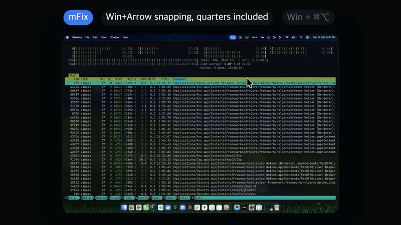

**Snap Layouts.** Hover the green button for 600 ms and you get the Windows 11 grid of layouts instead of Apple's menu. Click a zone and the window goes there. The first one or two layouts are built from the windows you have open, with their icons in the zones. Pick one and they all land at once. Wide screens get six layouts, smaller ones four, portrait screens get stacked ones.

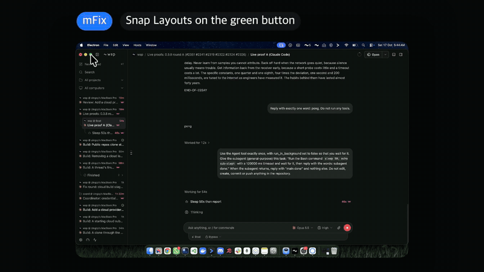

**Snap Assist.** After a window snaps, the empty part of the screen shows cards of your other windows. Pick one and it fills the gap. If more gaps are left, it moves to the next one. Arrows move, Enter picks, Esc stops, Delete closes the highlighted window.

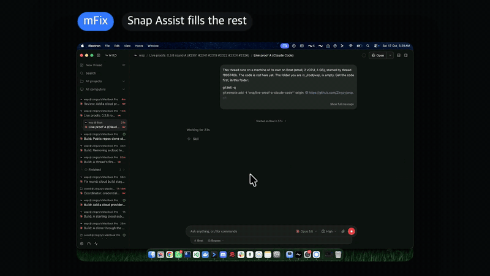

**Drag to snap.** Drag a window by its title bar to an edge for a half, a corner for a quarter, or the top to maximize. A preview shows where it lands. Esc cancels. Drag a snapped window away and it goes back to its old size, still under your pointer.

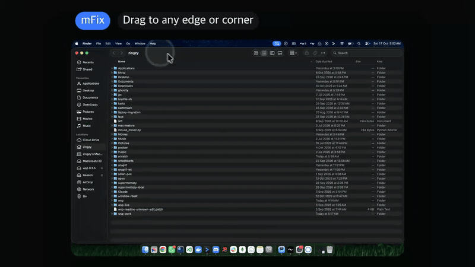

**Snap groups.** Windows you snap together through Snap Assist or a layout become a group. Resize one and its neighbours follow. The group is one card in the switcher, and picking it brings the whole group forward.

**Divider handle.** Hover the line where two snapped windows touch and a handle appears. Drag it to resize both sides at once. It works on any snapped windows that touch, grouped or not.

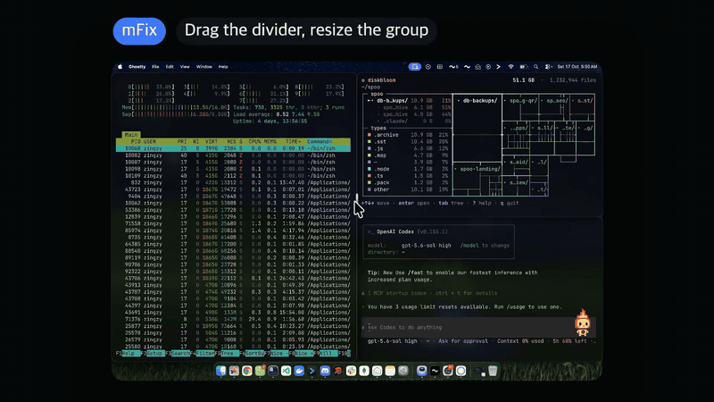

## Switcher

> **macOS:** Cmd+Tab shows apps, including ones with no windows open.
> **mFix:** Cmd+Tab shows windows, like Alt+Tab on Windows 11.

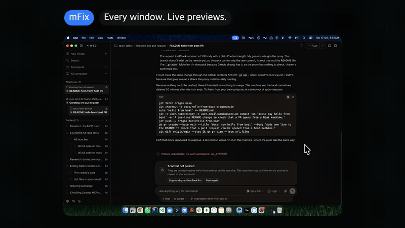

| Keys | What happens |
|---|---|
| Cmd+Tab | Open the switcher, or step to the next window. Let go of Cmd to switch. |
| Cmd+Shift+Tab | Step back. |
| Cmd+Ctrl+Tab | Open it and keep it open after you let go, like Ctrl+Alt+Tab. |
| Arrows | Move around the grid. |
| Enter or Space | Switch to the highlighted window. |
| Esc | Close the switcher and stay put. |
| Delete or W | Close the highlighted window. |

- One card per window, most recently used first. Minimized windows go last, as on Windows.
- Windows from every Space, or only the current one. Your pick in Settings.
- Apps with no windows don't show up. There's nothing to switch to.
- Thumbnails for every window, minimized ones and other Spaces included. The ones on screen stay live.
- A snap group is one card. Each card has a close button.
- Cards shrink as windows pile up, stay in two rows, then the panel scrolls.
- A quick Cmd+Tab under 90 ms switches without drawing the panel at all.
- It works mid-drag. Cmd+Tab while dragging a file, hover a card for half a second, and that window comes forward so you can drop into it.

Thumbnails refresh three times a second, and only while a panel is open. When nothing is showing, nothing is capturing.

## Desktop

> **macOS:** Mission Control, Exposé, Stage Manager, Show Desktop, Hide Others. Five features, none of them Win+D.
> **mFix:** Win+D.

| Keys | What happens |
|---|---|
| Win+Home | Minimize every window on this Space except the one in front. Press again to bring them back. |
| Win+D | Minimize everything to show the desktop. Press again to bring it all back. |
| Win+1 to Win+9 | The nth app in the Dock. Not running: open it. In the back: bring it forward. Already in front: step through its windows, or minimize it if it has one. |
| Cmd+Shift+Esc | Open Activity Monitor, the closest thing to Task Manager a Mac has. |


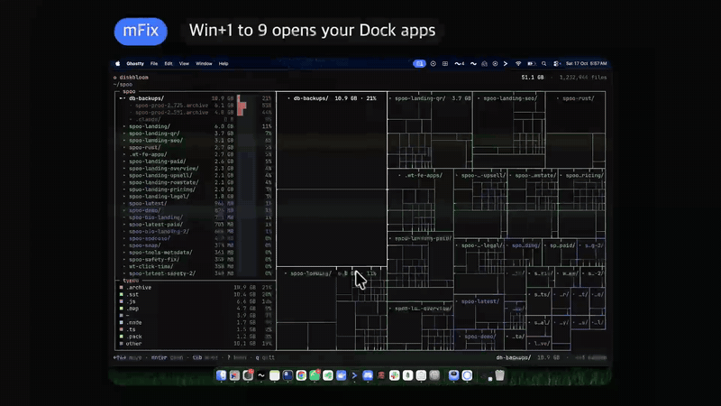

## Dock

> **macOS:** hover an icon, read the app's name.
> **mFix:** hover an icon, see its windows.

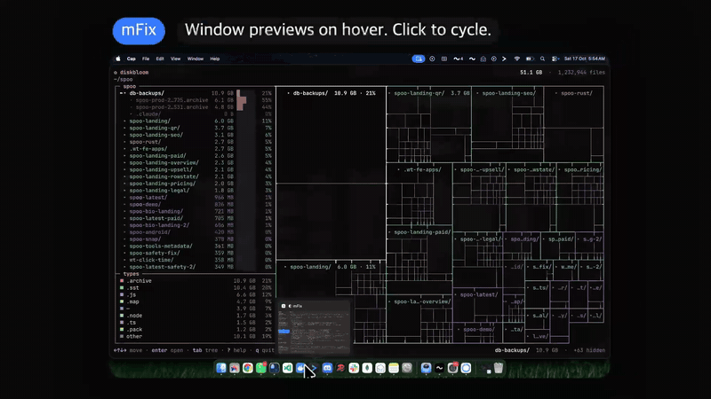

- Hover a Dock icon and its windows appear as cards above it at once. Click a card to go to that window, on any Space. Click its X to close it. Once one preview is open, moving to the next icon switches right away.
- The cards cover the Dock's name tooltip. That's as close as anyone has come to turning it off.
- Click the icon of the app you're already in and it minimizes, the way a taskbar button does. With several windows, each click steps to the next one.
- Works with the Dock at the bottom, left or right.

## Drag and drop

> **macOS:** a ghost of the file under your pointer, and good wishes.
> **mFix:** help.

- A small preview of what you're dragging sits next to the pointer: a stack of file thumbnails with a count, an image, or a snippet of text.
- Hold a drag over an app's Dock icon for half a second and its window comes forward, even from another Space or a full screen Space. Drop right into it.
- Cmd+Tab works while you drag. See [Switcher](#switcher).


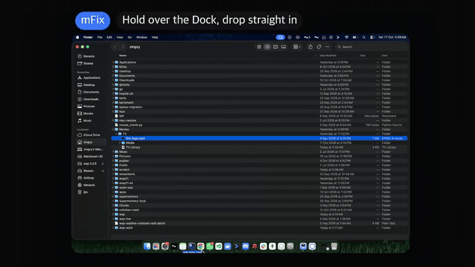

## Finder, but Explorer

> **macOS:** no Cut, Enter renames, Delete does nothing. **F\*CK MACOS.**
> **mFix:** the keys you already know.

They only apply when Finder is in front and focus is on files. Renaming, the search field, path boxes and dialogs keep their normal keys.

| Keys | Finder without mFix | Finder with mFix |
|---|---|---|
| Enter | Rename | Open |
| F2 | Brightness, probably | Rename. Most Mac keyboards need Fn+F2. |
| Delete | Nothing | Move to Trash |
| Shift+Delete | Nothing | Delete for good, after asking |
| Cmd+X, then Cmd+V | Nothing, then paste whatever you copied last | Move the files |
| Cmd+L | Nothing | Go to a typed path |
| Cmd+Option+T | Hide the toolbar | Open this folder in a terminal |

Cmd+V moves files into the selected folder when one is selected in list view, not just into the window's own folder. The terminal is Ghostty unless you pick cmux, iTerm, Warp or Terminal in Settings. mFix only lists the ones you have installed.


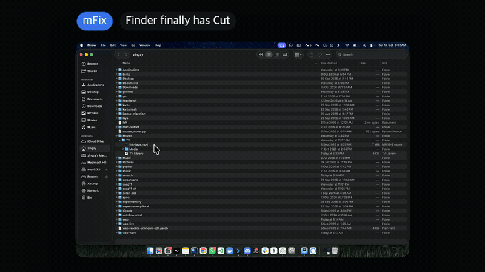

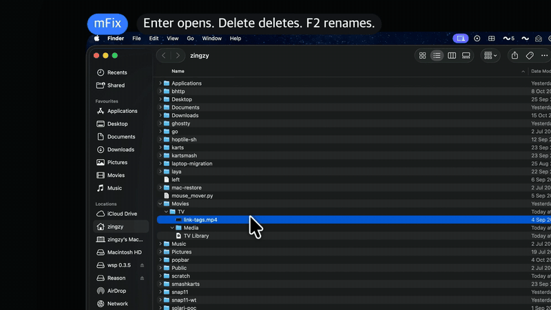

## Always on Top

> **macOS:** no.
> **mFix:** PowerToys' version, on a Mac.

| Keys | What happens |
|---|---|
| Cmd+Option+Ctrl+T | Pin the front window above everything else. Press again to unpin. |

A pinned window gets an accent border that follows that window's own corner radius, so it fits Tahoe's round windows and square ones alike. It stays on its own Space. Closing the window unpins it.

macOS gives one app no way to lift another app's window above the app in front. So while you work in another window, mFix lays a live copy of the pinned one exactly over it. Click the copy and the real window comes forward.

## Settings

Click the menu bar icon, then Settings. Every feature has a switch, changes apply at once, and each section lists its shortcuts with the Win keys you picked.

<picture>
  <source media="(prefers-color-scheme: dark)" srcset="docs/images/settings-dark.png">
  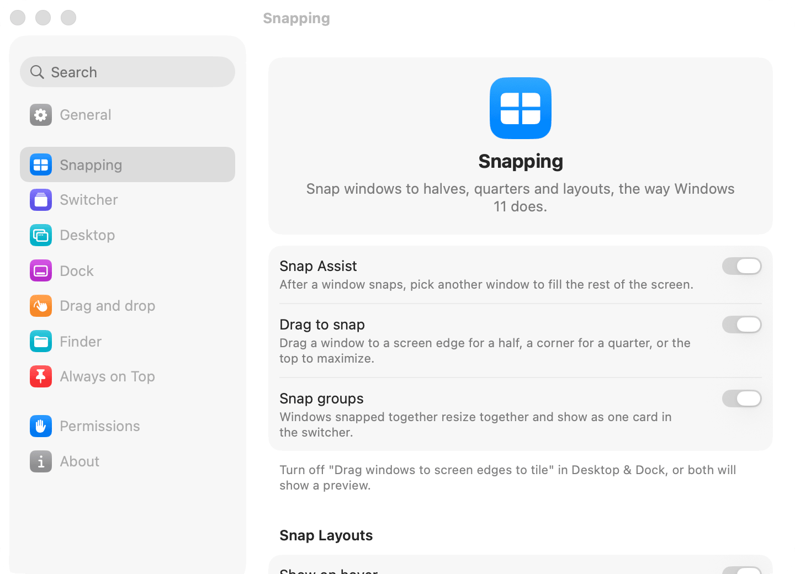
</picture>

| Section | What you can change |
|---|---|
| General | Open at login. Which keys stand for Win. |
| Snapping | Snap Assist, drag to snap, snap groups, Snap Layouts on hover and the hover delay. |
| Switcher | Replace Cmd+Tab, all Spaces or this one, the delay before the panel shows, live thumbnails. |
| Desktop | Win+Home and Win+D. |
| Dock | Dock previews and their delay, click to minimize or cycle, Win+1 to 9. |
| Drag and drop | The drag preview, Dock spring loading and how long to hold. |
| Finder | Finder keys and which terminal Cmd+Option+T opens. |
| Always on Top | Pinning with Cmd+Option+Ctrl+T. |
| Permissions | Whether each permission is granted, with a button to its list in System Settings. |
| About | Version, source code and license. |

## The fine print

### What mFix changes on your Mac

To own Cmd+Tab, mFix turns off the system's Cmd+Tab and Cmd+Shift+Tab while it runs. When Win is Cmd+Option and Win+D is on, it also turns off Cmd+Option+D, the Dock hiding shortcut. It saves how each one was and puts them back when it quits, when it crashes, and on the next launch if it was force killed.

mFix uses private macOS functions for things no public API does, like capturing minimized windows and bringing one window of another app forward. A macOS update can break them. Apple could also just ship this. They won't.

### Privacy

Nothing leaves your Mac. mFix has no networking code, no telemetry, no analytics, no update checks and no accounts. Window thumbnails stay in memory and are never written to disk. The full list is in [PRIVACY.md](.github/PRIVACY.md).

### Uninstall

Quit mFix from its menu bar icon, so it puts Cmd+Tab back. Drag it from Applications to the Trash. Remove it from Accessibility and Screen Recording in Privacy & Security. Its settings live in `~/Library/Preferences/dev.zingzy.mfix.plist`.

### Build from source

You need macOS 26 and Xcode 26, for the macOS 26 SDK.

```sh
swift build
swift test
scripts/build.sh     # build/mFix.app
scripts/dmg.sh       # build/mFix.dmg
```

`scripts/build.sh` signs ad hoc unless it finds a signing certificate, and an ad hoc build makes macOS ask for permissions again after every rebuild. [docs/releasing.md](docs/releasing.md) shows how to sign with a stable certificate. [CONTRIBUTING.md](.github/CONTRIBUTING.md) covers the checks.

### Not affiliated

mFix is not affiliated with, endorsed by or sponsored by Microsoft or Apple. Windows, Windows 11, PowerToys, macOS, Finder and Dock are trademarks of their owners. mFix just copies the good ideas from one and puts them on the other.

### License

[MIT](LICENSE)
